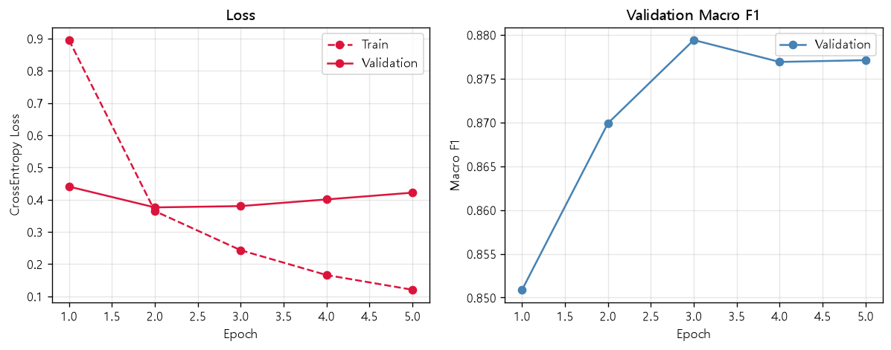
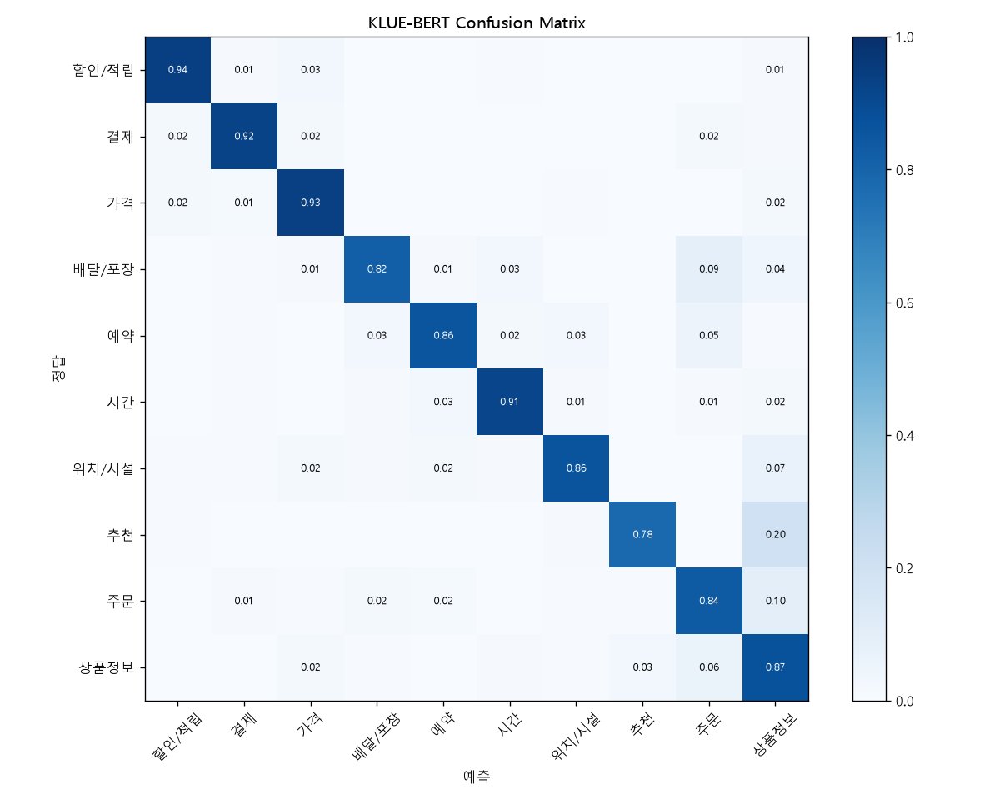

# KLUE-BERT로 고객 문의 의도 분류하기

## 1. 문제 정의

고객이 가게나 민원 창구에 한 질문을 보고, 어떤 의도로 물어본 것인지 10가지 중 하나로 분류하는 미니 프로젝트이다.

ex) 이거 카드 결제 되나요? -> 결제로 예측

프로젝트에서 사용한 의도 10종은 다음과 같다.

| 의도 | 예시 |
|---|---|
| 할인/적립 | 통신사 할인 되나요? |
| 결제 | 카드로 계산할게요 |
| 가격 | 이 메뉴 얼마예요? |
| 배달/포장 | 집까지 배달도 해주시나요? |
| 예약 | 다음 주 토요일에 4명 예약 가능한가요? |
| 시간 | 주말에도 문 여나요? |
| 위치/시설 | 근처에 주차할 곳 있어요? |
| 추천 | 제일 잘 나가는 게 뭐예요? |
| 주문 | 아이스 아메리카노 두 잔 주세요 |
| 상품정보 | 이 바지 다른 색상도 있나요? |

## 2. 사용한 모델과 데이터셋

#### 데이터셋

- 데이터 출처: AI Hub ([https://aihub.or.kr/aihubdata/data/view.do?currMenu=115&topMenu=100&dataSetSn=116](https://aihub.or.kr/aihubdata/data/view.do?currMenu=115&topMenu=100&dataSetSn=116))
    - 소상공인 및 공공 민원 10개 분야에 대한 50만 건 이상의 대화를 제공하는 자연어 데이터라고 설명되어 있음
- 파일: 업종별 엑셀 13개 (A 음식점(15,726)_new.xlsx ~ m 차량등록_최종본(250814).xlsx)

파일 내부

엑셀 구조가 두 종류였다.

| 데이터 | 사용한 열 | 의미 |
|---|---|---|
| 소상공인 | SPEAKER | 고객 / 점원 |
|  | SENTENCE | 문장 |
|  | MAIN | 의도 라벨 |
|  | QA | 질문(Q) / 대답(A) |
| 민원 | 화자 | 민원인 / 상담사 |
|  | intent (차량등록은 main) | 의도 라벨 |
|  | question | 질문 |

- 정제 과정에서 domain(업종), text(문장), main(원본 의도), intent(10개 의도), label(숫자) 열로 통일했다.
- 정제 후 최종 데이터: 문장 28,742개

| 의도 | 상품정보 | 가격 | 주문 | 시간 | 위치/시설 | 결제 | 할인/적립 | 추천 | 배달/포장 | 예약 |
|---|---|---|---|---|---|---|---|---|---|---|
| 개수 | 8,474 | 5,318 | 2,596 | 2,331 | 2,317 | 2,032 | 1,929 | 1,447 | 1,321 | 977 |

#### 모델

- klue/bert-base (KLUE-BERT, Hugging Face)
- 한국어에 대해 사전 학습된 BERT 계열 모델. Transformer 기반 언어 모델

## 3. 전처리 과정

#### 데이터 정제

1. 엑셀 구조 통일
    - 소상공인 파일과 민원 파일의 열 구성이 다르고, 민원 파일끼리도 열 이름이 조금씩 달랐다(차량등록은 첫 열 이름이 깨져 있고 intent 대신 main).
    - 열 이름 대신 위치로 필요한 열을 꺼내서 domain, text, main 세 개로 통일했다.
    - 분류 대상은 고객이 한 질문이므로 소상공인은 SPEAKER == 고객 & QA == Q, 민원은 화자 == 민원인인 문장만 사용했다. (46,771개)
2. 결측치 처리
    - 문장 1개, 의도 29개가 비어 있었다. 의도가 빈 문장은 "다음에 다시 올게요"처럼 질문이 아닌 문장이 대부분이라 삭제했다.
3. 의도 라벨 정리
    - 원본 의도 라벨이 2,607종이었다. 띄어쓰기를 통일해도(가격 문의 / 가격문의) 2,454종이었다.
    - 대부분 제품가격문의, 염색가격문의, 펌가격문의처럼 업종만 다르고 의도는 같은 라벨이었다.
    - 원본 라벨에 들어 있는 키워드로 10개 의도로 묶었다. 위에서부터 먼저 걸리는 의도로 정해서 현금결제할인문의는 할인/적립, 배달시간문의는 배달/포장, 메뉴추천요청은 추천이 되도록 순서를 정했다.
    - 키워드를 추가할 때는 그 키워드에 걸리는 문장을 직접 확인했다.
        - 과일, 면적은 "사과 있나요?", "36평 매물 있어요?"처럼 모두 상품정보에 맞아서 그대로 추가했다.
        - 자리는 "자리 있나요?" 같은 문의와 "자리 좀 바꿔주세요" 같은 요청이 섞여 있어서 빈자리, 자리여부, 자리배치처럼 자리가 있는지, 어디인지 묻는 라벨만 위치/시설로 묶었다.
        - 고기는 "한우 2근만 주세요"(국산고기요청)처럼 사실은 주문인 라벨이 있어서 고기요청은 주문으로, 기타고기문의만 상품정보로 묶었다. 상품정보와 추천이 섞인 용도별고기문의는 제외했다.
    - 구비서류, 과표처럼 특정 업종에서만 나오거나 숙박문의, 상담문의처럼 너무 넓은 라벨은 제외했다. (1,226종, 15,399개 문장)
4. 중복 문장 제거
    - 같은 문장인데 의도가 다른 문장 58개는 정답을 정할 수 없어서 삭제했다. ("가격이 어떻게 되죠?"가 가격과 추천으로 동시에 붙어 있었음)
    - 같은 문장이 Train, Test에 각각 들어가면 성능이 부풀려지므로 중복 문장 2,326개는 하나만 남겼다.
5. Train / Validation / Test 분리
    - 70% / 15% / 15%로 나누고, stratify로 의도 비율을 똑같이 맞췄다.
    - Train 20,119개, Validation 4,311개, Test 4,312개

#### Tokenizer를 이용한 전처리

- Special Token: [CLS](2) 문장 전체를 대표, 분류에 사용 / [SEP](3) 문장 끝 / [PAD](0) 길이 맞추기 / [UNK](1) vocabulary에 없는 token
- MASK 토큰은 사전 학습(MLM)에만 쓰이고 의도 분류 Fine-tuning에는 필요 없어서 확인하지 않았다.
- Subword 토큰화: 학원은 수업료 할인하고 그런 날은 없겠죠? -> [CLS] 학원 ##은 수업료 할인 ##하고 그런 날 ##은 없 ##겠 ##죠 ? [SEP]
- MAX_LEN = 128: 문장을 128 토큰으로 맞췄다. 길면 자르고, 짧으면 뒤를 [PAD]로 채운다.
- 출력
    - input_ids: Token을 vocabulary 번호로 바꾼 값
    - attention_mask: 실제 Token(1)과 [PAD](0)를 구분해서 [PAD]를 참고하지 않도록 알려주는 값
- 최종 크기: input_ids (20,119, 128), attention_mask (20,119, 128), labels (20,119)

## 4. 모델 구조

AutoModelForSequenceClassification

| 층 | 설정 |
|---|---|
| BERT (사전 학습) | klue/bert-base, Transformer Encoder 12층, hidden 768 |
| Dropout | 0.1 |
| 출력층 (classifier) | Linear(768, 10): [CLS] 위치의 벡터로 10개 의도 점수 출력 |

#### 동작 순서

1. 문장 -> Token ID: Tokenizer가 문장을 Subword로 나누고 앞뒤에 [CLS], [SEP]를 붙인다.
2. 문맥 파악: BERT가 Self-Attention으로 모든 Token이 서로를 참고하면서 문장 전체의 의미를 파악한다.
3. 문장 요약: 문장 전체를 대표하는 [CLS] 위치의 768차원 벡터를 꺼낸다.
4. 의도 예측: Linear 층이 10개 의도 점수(logits)를 출력하고, Softmax로 확률로 바꿔 가장 높은 의도를 고른다.

## 5. 학습 방법 (Fine-tuning)

| 항목 | 설정 |
|---|---|
| Loss | CrossEntropyLoss (problem_type="single_label_classification") |
| Optimizer | AdamW (weight_decay=0.01) |
| Learning Rate | 2e-5 |
| Scheduler | Linear Warmup (전체 step의 10%) 후 Linear Decay |
| Batch Size | 32 |
| Epoch | 5 (전체 3,145 step) |
| Gradient Clipping | max_norm = 1.0 |

- Full Fine-tuning: 사전 학습된 BERT 파라미터와 새로 붙인 분류층 파라미터를 모두 업데이트했다.
- 가중치 저장 기준: 의도마다 문장 수가 다르므로 Validation Macro F1를 기준으로 가중치를 저장했다.

| Epoch | Train Loss | Valid Loss | Valid Macro F1 |
|---|---|---|---|
| 1 | 0.8952 | 0.4404 | 0.8509 |
| 2 | 0.3644 | 0.3758 | 0.8699 |
| 3 | 0.2430 | 0.3799 | 0.8794 |
| 4 | 0.1660 | 0.4006 | 0.8769 |
| 5 | 0.1204 | 0.4215 | 0.8771 |

## 6. 결과 및 평가

의도마다 문장 수가 달라서 Accuracy와 함께 모든 의도를 똑같이 중요하게 보는 Macro F1을 주요 지표로 사용했다.

| (Test, 4,312개 문장) | Accuracy | Macro F1 |
|---|---|---|
| KLUE-BERT | 0.8824 | 0.8728 |

의도별 성능

| 의도 | Precision | Recall | F1 | Test 개수 |
|---|---|---|---|---|
| 가격 | 0.9384 | 0.9348 | 0.9366 | 798 |
| 할인/적립 | 0.9125 | 0.9377 | 0.9249 | 289 |
| 시간 | 0.9329 | 0.9143 | 0.9235 | 350 |
| 결제 | 0.9186 | 0.9246 | 0.9216 | 305 |
| 위치/시설 | 0.9202 | 0.8621 | 0.8902 | 348 |
| 상품정보 | 0.8831 | 0.8678 | 0.8754 | 1,271 |
| 예약 | 0.8224 | 0.8562 | 0.8389 | 146 |
| 배달/포장 | 0.8571 | 0.8182 | 0.8372 | 198 |
| 추천 | 0.8173 | 0.7834 | 0.8000 | 217 |
| 주문 | 0.7309 | 0.8359 | 0.7799 | 390 |

Confusion Matrix (실제 의도 기준 비율)

## 7. 새로운 문장 예측

| 문장 | 1등 | 2등 |
|---|---|---|
| 이 메뉴 얼마예요? | 가격(0.99) | 상품정보(0.00) |
| 통신사 할인 되나요? | 할인/적립(0.99) | 가격(0.01) |
| 카드로 계산할게요 | 결제(0.99) | 주문(0.00) |
| 아이스 아메리카노 두 잔 주세요 | 주문(0.99) | 결제(0.00) |
| 팝콘 큰 거 하나랑 콜라 두 개 주세요 (영화관) | 주문(0.99) | 배달/포장(0.01) |
| 일요일에도 진료하나요? (병원) | 시간(0.99) | 예약(0.00) |
| 엘리베이터는 어디에 있어요? | 위치/시설(1.00) | 가격(0.00) |
| 배달비는 얼마예요? | 가격(0.99) | 배달/포장(0.00) |
| 화장실 비밀번호가 뭐예요? | 위치/시설(0.99) | 예약(0.00) |
| 사장님 혹시 MBTI가 뭐예요? | 상품정보(0.96) | 추천(0.03) |

10개 의도 밖의 문장인 "오늘 날씨가 정말 좋다"는 상품정보(0.43), 시간(0.19) 순으로 예측되었다.

## 8. 문제점과 개선 방향

- 키워드로 묶은 라벨의 노이즈
    - 원본 라벨 이름의 키워드만 보고 묶어서 배달비문의(가격 or 배달/포장)처럼 두 의도에 걸치는 라벨이 하나로 정해졌다.
    - 모델이 확신하는데 정답과 다른 문장의 라벨을 다시 확인하거나, 여러 의도를 가질 수 있는 Multi-label 분류로 바꾸는 방법이 효과적일 것이다.
- 메뉴/제품 이야기를 하는 의도끼리 헷갈림
    - 추천의 20%, 주문의 10%가 상품정보로 예측되었다. 셋 다 메뉴나 제품을 이야기하는 문장이라 경계가 애매하다.
    - 세 의도의 기준을 더 세세하게 정하거나, 헷갈리는 문장을 더 모아서 학습해야 할 것이다.
- 의도 밖의 문장
    - "MBTI가 뭐예요?" 같은 잡담도 무조건 10개 중 하나로 분류하고, 상품정보(0.96)로 강하게 확신했다.
    - 잡담 문장을 모아 기타 의도로 넣어 학습하는 방법을 고려할 수 있다.
- 데이터 불균형
    - 상수도 303개, 여권 273개로 의류(7,570개)에 비해 데이터가 매우 적다.
    - 데이터가 적은 업종의 문장을 더 모야할 것이다.
